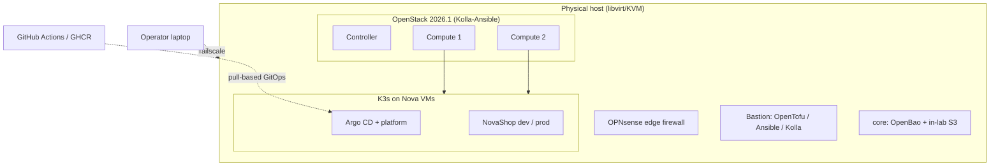

# akasha

A private cloud and Kubernetes platform built the way production teams build them —
OpenStack as the IaaS layer, Kubernetes on top, GitOps delivery, CI/CD running inside the
cluster, and security, monitoring and operations treated as first-class concerns — all on a
single school-provided machine.

> **Status:** design complete, implementation started.
> See the [roadmap](docs/roadmap.md) for the current étape.

## Architecture



| Layer | What | Tooling |
|---|---|---|
| L0 Host | libvirt VMs, Linux bridges, nftables, OPNsense, bastion, OpenBao | OpenTofu, Ansible |
| L1 OpenStack | 1 controller + 2 computes, ML2/OVN, Octavia, Cinder | Kolla-Ansible 2026.1 |
| L2 Cloud resources | projects, users, networks, images, flavors | OpenTofu |
| L3 Kubernetes | K3s on Nova with OCCM and Cinder CSI | OpenTofu, Ansible |
| L4 Platform | Argo CD, Traefik/Gateway API, cert-manager, External Secrets, Kyverno, CloudNativePG, Prometheus/Loki | Argo CD (`akasha-gitops`) |
| L5 Application | NovaShop (frontend, API, PostgreSQL) | GitHub Actions + ARC, GitOps |

Every multi-node property runs on one physical failure domain; the
[architecture overview](docs/architecture/overview.md#7-production-north-star-not-built-here)
lists what the lab reproduces and what it cannot.

## Documentation

- [Architecture overview](docs/architecture/overview.md) — goals, layers, budgets, production north star
- [Architecture Decision Records](docs/adr/README.md) — why each choice was made
- [Research notes](docs/research/README.md) — sourced findings behind the decisions
- [Open questions](docs/open-questions.md) — pending tests and deferred decisions
- [Development setup](docs/development.md) — pinned, verified toolchain (mise + uv)

## Repository layout

```
infra/opentofu/   OpenTofu stacks, one state per layer
infra/ansible/    host, bastion and K3s configuration
infra/kolla/      Kolla-Ansible configuration as code
apps/novashop/    application source, image and chart
docs/             ADRs, architecture, research, runbooks
```

The companion repository [`akasha-gitops`](https://github.com/akasha-platform/akasha-gitops)
holds the desired state that Argo CD applies.

## Origin

akasha started as a school exercise (TD2: Terraform → Ansible → Helm deploying NovaShop on a
single K3s VM in DevStack). That deliverable is preserved at tag
[`td2-final`](https://github.com/akasha-platform/akasha/tree/td2-final); its assessment is in
[research/00](docs/research/00-td2-baseline-assessment.md).

## Security

See [SECURITY.md](SECURITY.md). The lab is not exposed to the Internet.

## License

Copyright 2026 Dinh Huy NGUYEN. Licensed under the [Apache License 2.0](LICENSE).
